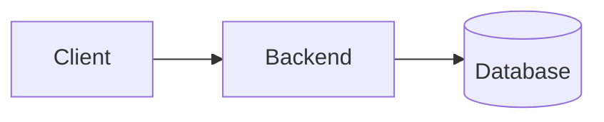

# Topic Name: Short Subtitle

One paragraph: what this guide covers (list the main areas) and who it is for (beginner to engineer). Mention the main tools or languages used in the examples.

---

## Quick summary

- The topic in one sentence.
- The 3 to 6 ideas that matter most.
- The default recommendation ("start with X, add Y only when Z").
- The most important safety or correctness rule.

---

## Table of contents

1. [Big picture](#1-big-picture)
2. [Core concepts](#2-core-concepts)
3. [Fundamentals](#3-fundamentals)
4. [Practical usage](#4-practical-usage)
5. [Advanced topics](#5-advanced-topics)
6. [Full example](#6-full-example)
7. [Checklist: things to remember](#7-checklist-things-to-remember)
8. [Common pitfalls and interview questions](#8-common-pitfalls-and-interview-questions)

Related guides: [Guide A](guide-a.md), [Guide B](guide-b.md).

---

## 1. Big picture

What problem does this solve? Where does it fit in a backend system? Add one Mermaid diagram if the flow matters.



---

## 2. Core concepts

Definitions in a table:

| Term | Meaning |
|---|---|
| **Term one** | Plain-language definition |
| **Term two** | Plain-language definition |

---

## 3. Fundamentals

Explain the "why" next to each rule. Compare options in tables:

| | Option A | Option B |
|---|---|---|
| Best for | ... | ... |
| Cost | ... | ... |

---

## 4. Practical usage

Commands or code the reader can run. Comment the lines that carry a lesson.

```python
# short, correct, runnable example
```

---

## 5. Advanced topics

Scaling, security, performance, operations, edge cases. Link to sibling guides instead of repeating their content.

---

## 6. Full example

A small, complete example (files, commands to run, what to try, and what is intentionally missing for a real service).

---

## 7. Checklist: things to remember

1. First thing to remember.
2. Second thing to remember.

---

## 8. Common pitfalls and interview questions

**Pitfalls**

- Common mistake and its consequence.

**Interview questions**

- **Question?**
  Short answer in one to three sentences.
